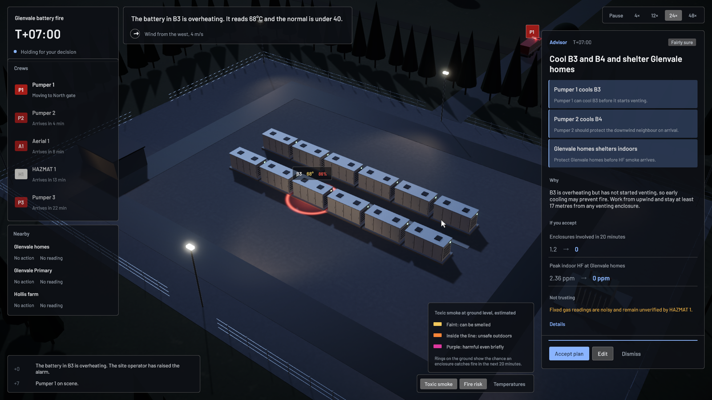
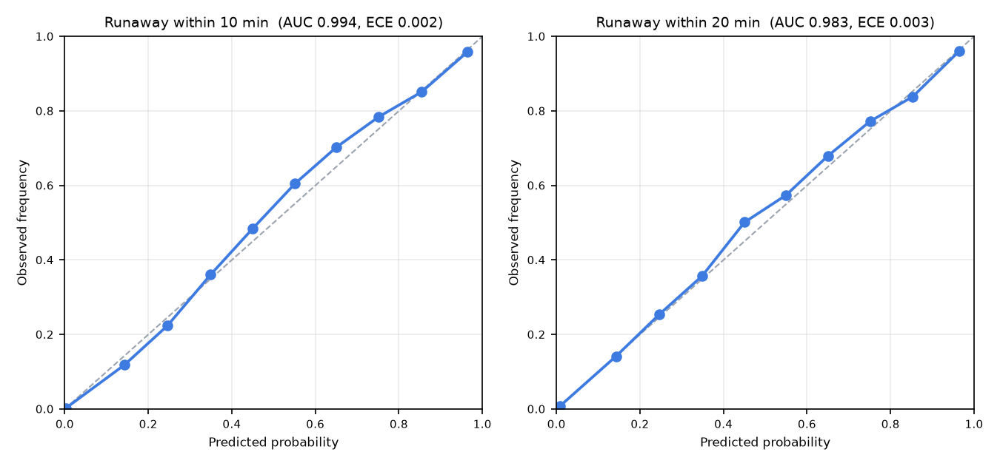

# Runaway

A Unity incident-command simulator for a fire at a grid-scale battery storage site. An agentic AI advisor reads the incident through tools, tests its plans in the simulation before it speaks, and hands a short plan to the human Incident Controller, who accepts, edits or dismisses it. Every decision is logged and replayed afterwards to show what would have happened otherwise.

It is built around the questions in human-centric agentic AI for emergency decision support. When should a commander trust an agent's call? How should an agent behave when its own sensors are wrong? How do you measure whether advice helped?



## The scenario

Night at the Glenvale grid battery: twelve battery enclosures in two rows, a transformer, a control room, and homes and a primary school a few hundred metres away. Enclosure B3's battery overheats and goes into thermal runaway. Five appliances arrive over half an hour.

The fire behaves like a lithium-ion battery fire:

- An enclosure in runaway vents flammable gas, then ignites. Water will not put it out. The job is to keep its neighbours cool.
- Heat spreads to neighbours 0.9 m away in the same row, more strongly downwind. The far row is exposed when the wind blows across the aisle.
- A venting enclosure can explode. Crews must keep about 17 m away.
- Burning batteries release hydrogen fluoride (HF). The smoke drifts with the wind toward the homes or the school. Sheltering indoors is fast. Evacuating takes about 20 minutes and moves people through the smoke.
- Crews accumulate smoke exposure when they work downwind and must rest once they hit the limit.

Two things go wrong that nobody tells you about. A3's battery sensor freezes at a normal reading, and the site's wind sensor jams just before the wind swings toward the school. The only way to catch either is to cross-check against Aerial 1's thermal camera and the smoke you can see.

## How the AI works

The AI has three parts, each doing what it is good at.

1. **Spread forecaster (deep learning, in-engine).** A two-layer graph neural network over the twelve enclosures. It predicts each one's chance of thermal runaway within 10 and 20 minutes, using only what the sensors report. It was trained in PyTorch on 4,000 simulated incidents with randomised wind, faults and responses, exported to ONNX and run inside Unity with Unity's Inference Engine. The forecast drives the risk rings on the ground and is one of the advisor's tools.
2. **Planner (agentic LLM).** Codex runs headless (`codex exec`, GPT-6.1 Sol) with only five incident tools available through MCP. It reads the situation, cross-checks sensors, reads the forecast, tests candidate plans, and reads lessons from earlier exercises. It returns a structured card: plan, reasons, expected effect and confidence. Shell, web and other built-in tools are switched off.
3. **Safety judgement (prompt and code together).** Firefighting doctrine lives in the planner's brief as judgement, and the simulation enforces only what is physically impossible. The test tool returns cautions, such as a hose position inside a venting enclosure's blast radius or opening doors on unverified gas, for the planner to weigh and explain. The same checks warn the human when they give orders by hand.

The planner never sees ground truth. Its test tool builds a belief from observations and runs the plan 16 times against keeping the current orders. A frozen sensor therefore misleads the tool exactly as it would mislead a person, unless the planner notices and tests under a corrected assumption.

```
Unity app (C#)                                      Codex (GPT-6.1 Sol)
  Incident simulation  <── loopback HTTP API ──>  MCP tools (Python)
  Spread forecaster (Inference Engine)              get_situation, get_sensor_check,
  Commander console (UI Toolkit)                    get_forecast, test_plan, read_lessons
  Decision log, counterfactual replay, lessons     -> structured plan card (JSON schema)
```

The simulation core is plain C# with no Unity dependency. The same files run inside Unity and in a headless .NET runner, which generates training data and runs evaluations. Runs are deterministic, so any decision can be replayed with different choices.

## The commander's screen

- **What's happening:** a plain summary written from observations, such as "B3 is on fire. B2 is heating up and could catch fire next. Smoke is blowing north-east toward Glenvale Primary."
- **Crews and Nearby:** what each crew is doing, and how each community is protected.
- **Advisor card:** the plan, why, and what it should change, with details on request. The clock pauses while the advisor works and while you decide.
- **Views:** estimated toxic smoke on the ground, fire-risk rings, and a temperature view.
- **After-action review:** outcome, a timeline of how many enclosures were involved, each decision with what would have happened otherwise, the hidden faults revealed, and lessons the advisor writes for next time.

There are three modes for comparing reliance on AI: advisor with reasoning, advisor with actions only, and no advisor.

## Results

**Spread forecaster**, on 400 held-out simulated incidents:

| Horizon | AUC | Simple heuristic AUC | Brier | Base-rate Brier | Calibration error |
|---|---|---|---|---|---|
| 10 minutes | 0.994 | 0.949 | 0.013 | 0.055 | 0.002 |
| 20 minutes | 0.983 | 0.893 | 0.030 | 0.099 | 0.003 |



**Response policies:**

RESULTS_TABLE

## Run it

Requirements: macOS on Apple silicon, Unity 6.3 LTS (6000.3.28f1), .NET 10 SDK, `uv`, and the Codex CLI signed in.

```bash
# headless simulation, training data, forecaster
dotnet run -c Release --project tools/simrunner -- calibrate
dotnet run -c Release --project tools/simrunner -- datagen 4000 ml/data 1000
(cd ml && uv run python train.py)

# advisor tools
(cd advisor && uv sync)

# build and run the Unity app
tools/build.sh all
open build/Runaway.app

# headless advisor-in-the-loop run (the simulated commander accepts every card)
dotnet run -c Release --project tools/simrunner -- advise 7 accept eval/run.json
```

`Runaway.app -capture <dir>` records the scripted demo, and `-preview <dir> -cards <run.json>` renders review stills.

## Layout

| Path | What |
|---|---|
| `Runaway/Assets/Runaway/Sim` | Incident simulation, sensors, observations, belief rollouts, safety checks, forecaster features |
| `Runaway/Assets/Runaway/Advisor` | Advisor tools, prompts, Codex runner, decision triggers, counterfactual replay, lessons |
| `Runaway/Assets/Runaway/App` | Unity views, commander console, camera, demo recorder |
| `advisor/` | MCP server exposing the incident tools to Codex |
| `ml/` | Forecaster training and ONNX export |
| `tools/simrunner` | Headless .NET runner: calibration, data generation, sweeps, advisor runs |
| `eval/` | Evaluation outputs |
| `docs/` | Forecaster report and images |

## Limits

- The fire, smoke and exposure models are tuned to behave plausibly, not validated against real incident data. Numbers are for comparing decisions inside the exercise.
- The simulation pauses while the advisor thinks, typically 20 to 40 seconds. The recorded demo time-lapses those pauses.
- Headless advisor runs accept every card, which measures the advisor, not a human working with it. The three modes in the app are there for that kind of study.

## Credits

Barlow typeface by Jeremy Tribby, SIL Open Font License. Built with Unity 6.3 LTS, Unity Inference Engine, PyTorch and the Codex CLI.
